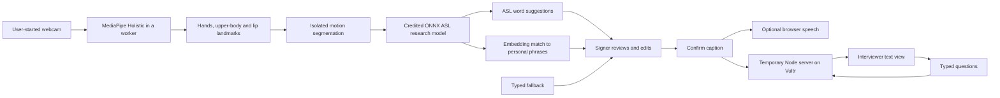

> Current target: Veritas AI International High School Hackathon 2026, AI + Health. See VERITAS_PREPARATION.md for the current event requirements and INTERVIEW_WORKFLOW.md for implemented behavior. Earlier concept notes below are historical.

# Handsay: strengthen communication without taking over the speaker's meaning

## Product statement

Handsay aims to help signing and nonspeaking people communicate with people who do not know their signs: movement becomes a suggested word or personally chosen phrase; the signer controls the caption and voice. The first prototype focuses on isolated ASL vocabulary and personalized phrase shortcuts in a two-person conversation.

Not everyone who is nonspeaking uses sign language, and not every Deaf person is nonspeaking. Co-design should include people who actually want this tool, fluent ASL signers and accessibility specialists. The prototype does not replace an interpreter or other communication accommodation.

## What makes the idea stronger

- **Signer control:** review and edit captions; live text sharing is an explicit opt-in, while speech and confirmed transcript entries still require confirmation. Preserve exact wording; do not let an LLM invent interview answers or change meaning.
- **Personal phrases:** a motion the person chooses can say an exact phrase, including interview requests such as “Could you repeat the question?” This is an AAC-style shortcut, separate from ASL recognition.
- **Two-sided access:** the interviewer sees confirmed captions on another screen and can type questions back. Neither person must learn the other's signs to use this narrow workflow.
- **Privacy:** local video inference, no raw camera uploads, explicit sharing of confirmed text, short-lived rooms.
- **Honest uncertainty:** research model suggestions, rejection below a threshold, incomplete framing feedback, and a type-to-speak fallback. No guaranteed accuracy claim.

## 10,000 sensors: engineering correction

Ten thousand physical hand sensors cannot be manufactured or validated through software. More channels do not alone fix language ambiguity, misplaced sensors, calibration errors, drift, occlusion or missing facial/body information. Detecting every tiny movement is not the same as understanding intended language, and suppressing harmless motion can also matter.

This webcam prototype uses **zero physical hand sensors** and up to **543 estimated landmarks**. These landmarks must never be advertised as 10,000 sensors or 10,000 independent measurements. Duplicating or interpolating landmarks does not create physical observations.

A future glove should start from measured requirements: useful finger-joint angles, finger contact, palm orientation and wrist motion. Evaluate stretch/flex sensing, inertial sensing and contact sensing against a camera-only baseline. Select channel count after measuring which sensors improve recognition under occlusion; retain face/body tracking for linguistic information that gloves cannot observe. A 10,000-element tactile array would be a separate hardware R&D project and would need a demonstrated benefit, power/bandwidth budget, comfort testing and a calibrated spatial layout.

## Current architecture

The backend is a real part of the product: it coordinates authenticated temporary text rooms. ML remains local to avoid uploading signing video. Vultr Compute hosts the backend and can also serve the frontend and model assets.

## What is needed before a real interview

1. Recruit fluent ASL signers and intended users; confirm the workflow is wanted and identify interaction barriers in gesture recording and confirmation.
2. Establish a licensed, appropriate interview corpus and evaluation protocol. Split by signer, not by adjacent frames. Include diverse camera views, body types, skin tones, signing speeds and lighting.
3. Test continuous sequence translation, facial grammar, sign boundaries, fingerspelling and out-of-vocabulary rejection. The current isolated-word model does not provide these.
4. Measure word/sequence errors, rejection rates, false activations, end-to-end delay, correction effort and user preference. Test on new signers and unseen rooms; report failures, not just a best-case demo.
5. Evaluate accessible confirmation methods, optional foot/switch controls and communication accommodations. An interviewer must not treat a prototype's recognition error as the person's answer or ability.
6. Add reliable room lifecycle, moderation/access controls and operational monitoring before broader use. Complete a privacy/security review with the intended deployment.

## Useful public sources

- [NIDCD: American Sign Language](https://www.nidcd.nih.gov/health/american-sign-language): ASL has its own grammar, uses hands and face, and is not universal across countries.
- [Wen et al., Nature Communications, 2021](https://www.nature.com/articles/s41467-021-25637-w): research on wearable gloves and sign recognition using 15 sensor channels, with bounded datasets and reported errors. Sensor count alone is not a reliability guarantee.
- [GestureSign model card and limitations](https://github.com/shashank11yadav/GestureSign): isolated 250-sign recognition, model inputs, held-out evaluations, attribution and intended-use restrictions.

Current automatic caption behavior and acceptance checks are described in [LIVE_CAPTIONS.md](LIVE_CAPTIONS.md).
